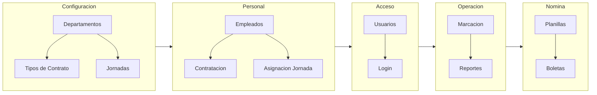
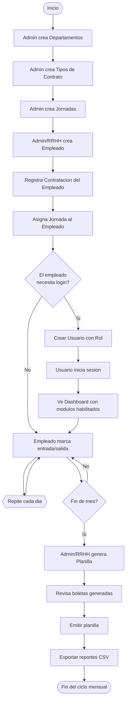

# User Flow — Sistema de Control de Asistencia y Planillas

## Visión General



---

## 1. Configuración Inicial (se hace una vez o esporádicamente)

### 1.1 Departamentos
```
Login como Admin → Gestion Departamentos → Crear: RRHH, Ingeniería, etc.
```
- Define las áreas/equipos de la empresa
- Cada empleado pertenece a UN departamento
- Los permisos pueden ser globales o por departamento

### 1.2 Tipos de Contrato
```
Login como Admin → Gestion Contratos → Crear: Indefinido, Fijo, Por Hora
```
- Catálogo que define las modalidades de contratación
- Cada contrato es de tipo **Fijo** (sueldo mensual) o **Por Hora** (pago por hora trabajada)

### 1.3 Jornadas Laborales
```
Login como Admin → Gestion Horarios → Crear: Matutina (07-16), Vespertina (13-22)
```
- Define horarios de entrada/salida esperados
- Cada jornada tiene un **margen de tolerancia** en minutos
- Las jornadas se asignan a empleados individualmente

---

## 2. Gestión de Personal

### 2.1 Registrar Empleado
```
Admin/RRHH → Gestion Empleados → Nuevo → Completar:
  - Nombres y Apellidos
  - DUI (formato: 12345678-9)
  - Departamento (ej: Ingeniería)
  → Guardar
```

> ⚠️ En este punto el empleado existe pero **NO puede operar** todavía. Necesita:
> - Una **contratación** (para saber su salario)
> - Una **asignación de jornada** (para saber su horario)
> - Opcionalmente un **usuario** (para que pueda loguearse)

### 2.2 Asignar Contrato (Contratación)
```
Admin/RRHH → Registro Contratos → Nuevo → Seleccionar:
  - Empleado
  - Tipo de Contrato
  - Fecha de inicio
  - Salario base (si es Fijo) o Valor por hora (si es Por Hora)
  → Guardar
```

- El sistema de nómina SOLO considera empleados con contratación **Vigente**
- Un empleado puede tener contrataciones anteriores (historial salarial)

### 2.3 Asignar Jornada
```
Admin/RRHH → Asignacion Jornada → Seleccionar:
  - Empleado
  - Jornada (Matutina, Vespertina, etc.)
  - Fecha de inicio
  → Guardar
```

- Un empleado puede tener una sola jornada activa a la vez
- La jornada se usa para: calcular tolerancia, detectar retardos, saber horas que debió trabajar

### 2.4 Crear Usuario (opcional — solo si el empleado va a usar el sistema)
```
Admin → Gestion Permisos → Gestionar usuarios desde ahi o desde login → Crear:
  - Empleado vinculado
  - Username
  - Password
  - Rol: Admin | RRHH | Empleado
  → Guardar
```

**Roles:**
| Rol | Acceso |
|---|---|
| **Admin** | TODO — bypass de permisos, ve los 9 módulos |
| **RRHH** | Restringido: Empleados, Contratos, Planillas, Reportes |
| **Empleado** | Solo su propia marcación |

---

## 3. Operación Diaria

### 3.1 Login
```
Todos → Login → Usuario + Contraseña → Dashboard
```

El Dashboard muestra **solamente** los botones de los módulos a los que el rol tiene acceso.

### 3.2 Marcación de Entrada/Salida
```
Empleado o RRHH → Marcacion → Seleccionar empleado:
  - Marcar Entrada → timestamp actual
  - Marcar Salida  → timestamp actual
```

**Flujo de marcación en el día típico:**
```
08:00 → Empleado llega → Marca ENTRADA
17:00 → Empleado se va → Marca SALIDA
```

El sistema registra dos timestamps vinculados al ID del empleado. Con eso calcula:
- Horas trabajadas = Salida − Entrada
- Si entró después de HoraEsperada + Tolerancia → retardo
- Cada día debería tener al menos una entrada y una salida

---

## 4. Cierre del Mes (Nómina)

### 4.1 Generar Planilla
```
Admin/RRHH → Planillas → Seleccionar Mes y Año → Generar Planilla
```

**Lo que pasa internamente:**
1. El sistema busca **todos los empleados activos** que tengan **contratación vigente**
2. Por cada empleado:
   - Obtiene todas sus asistencias del mes
   - Calcula horas ordinarias y extra
   - Calcula deducciones (AFP, ISSS, ISR)
   - Genera una Boleta de Pago con: ingresos − deducciones = líquido a pagar
3. Guarda todo en una sola transacción (si falla, no queda a medias)

### 4.2 Revisar y Emitir
```
Planilla en Borrador → Revisar boletas → Emitir → Estado: Emitida
```

- Mientras está en **Borrador** se puede corregir
- Al **Emitir** queda fija para contabilidad
- Se puede **Anular** si hay error grave

### 4.3 Visualizar Boleta
```
Admin/RRHH → Reportes → Pestaña Planilla → Seleccionar planilla → Cargar Boletas
```

Cada boleta muestra:
- Empleado
- Sueldo base
- Horas trabajadas (ordinarias + extra)
- Ingresos totales
- Deducciones (AFP, ISSS, ISR)
- **Líquido a pagar**

---

## 5. Reportes

### 5.1 Reporte de Asistencia
```
Admin/RRHH → Reportes → Pestaña Asistencia → Seleccionar:
  - Empleado
  - Rango de fechas
  → Generar Reporte → Exportar CSV
```

### 5.2 Reporte de Planilla
```
Admin/RRHH → Reportes → Pestaña Planilla → Seleccionar planilla:
  - Cargar Boletas
  - Exportar CSV
```

---

## Diagrama de Flujo Completo (Secuencia Temporal)



---

## Resumen: Secuencia Paso a Paso (para tu día 1)

```text
Paso 1:  Admin crea "RRHH", "Ingeniería" como Departamentos
Paso 2:  Admin crea "Indefinido (Fijo)", "Por Hora" como Tipos de Contrato
Paso 3:  Admin crea "Matutina (07-16)" como Jornada
         ─────────────────────────────────────────────
Paso 4:  RRHH registra a "María García" en el depto RRHH
Paso 5:  RRHH le asigna un Contrato Indefinido con salario $1,200
Paso 6:  RRHH le asigna la Jornada Matutina
Paso 7:  Admin crea usuario "mgarcia" con rol RRHH para María
         ─────────────────────────────────────────────
Paso 8:  María (mgarcia) inicia sesión
Paso 9:  María ve su Dashboard con 4 módulos (Empleados, Contratos, Planillas, Reportes)
Paso 10: María registra un nuevo empleado "Carlos Martínez"
Paso 11: María le asigna contrato y jornada a Carlos
         ─────────────────────────────────────────────
Paso 12: Carlos (como Empleado) marca entrada al llegar
Paso 13: Carlos marca salida al irse
         ───────────────────────────────────────────── (Fin del mes)
Paso 14: María genera la Planilla del mes
Paso 15: María revisa las boletas
Paso 16: María emite la planilla
Paso 17: María exporta los reportes
```

---

## Notas importantes

- **Empleado ≠ Usuario**: Un empleado puede existir sin tener usuario (ej: obrero que no toca el sistema). El que marca no necesariamente es el que loguea.
- **Contrato vs Contratación**: Contrato es el catálogo (Indefinido, Fijo...). Contratación es la relación *empleado + contrato* con fechas y salario.
- **Ciclo mensual**: La planilla se genera UNA vez al mes. Las asistencias se acumulan durante el mes y se consolidan al generar la planilla.
- **RBAC**: Admin ve TODO. RRHH ve gestión de personal. Empleado solo su marcación.
